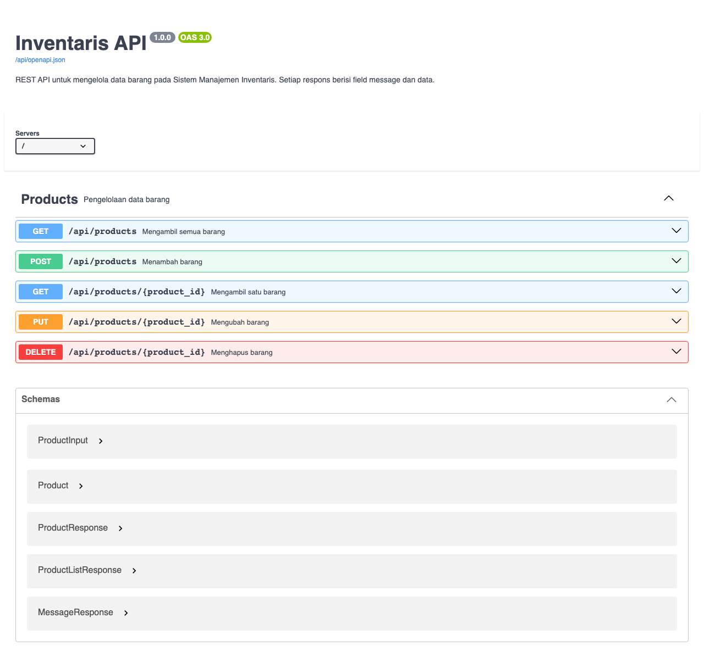

# Sistem Manajemen Inventaris

Project kelompok mata kuliah Service Oriented Architecture dengan tema Simple REST API.

## Penjelasan Aplikasi

Sistem Manajemen Inventaris adalah aplikasi web untuk mencatat data barang, yang terdiri dari nama barang, kategori, dan jumlah. Aplikasi ini memiliki satu layanan, yaitu Product Service, yang dibangun dengan Python dan Flask pada berkas `backend/app.py`. Layanan ini menyediakan REST API di alamat `/api/products` untuk menampilkan, menambah, mengubah, dan menghapus barang. Sebelum menyimpan data, Product Service memeriksa bahwa nama barang dan kategori sudah diisi dan tidak lebih dari 100 karakter, serta jumlah berupa bilangan bulat dari 0 sampai 2147483647. Setiap respons endpoint barang memakai format JSON yang sama, berisi `message` dan `data`. Format ini juga dipakai saat alamat tidak ditemukan, metode HTTP tidak didukung, atau database tidak dapat dihubungi.

Product Service terhubung ke PostgreSQL melalui `backend/database.py`, yang mengambil pengaturan koneksi dari berkas `.env`. Data barang tersimpan pada tabel `products` di database `db_soa`. Flask juga menyajikan antarmuka web yang dibuat dengan HTML, CSS, dan JavaScript. Antarmuka ini tidak mengakses database secara langsung: JavaScript mengirim permintaan ke REST API dengan `fetch`, lalu menampilkan hasilnya sebagai tabel barang dan pesan status. Kontrak API ditulis dalam format OpenAPI pada `backend/openapi.json` dan dapat dibaca melalui Swagger UI di `/api/docs`. Folder `bruno` berisi koleksi request untuk menguji endpoint, sedangkan folder `tests` berisi pengujian otomatis untuk API dan tampilan web.

## Tampilan Aplikasi

### Halaman Utama

Pengguna menambah atau mengubah barang melalui form, lalu melihat seluruh barang pada tabel yang dilengkapi tombol Ubah dan Hapus.

### Dokumentasi API

Halaman `/api/docs` menampilkan lima operasi pada endpoint barang beserta skema datanya.

## Anggota Kelompok

| No | Nama | NIM |
| --- | --- | --- |
| 1 | Steven Setiawan  | 32230107 |
| 2 | Kenisha Ellen | 32230114  |
| 3 | Renaldy Runtulalo | 32230132  |
| 4 | Keen Steven Lim | 32230134 |
| 5 | Darren Daniel | 32230138  |
