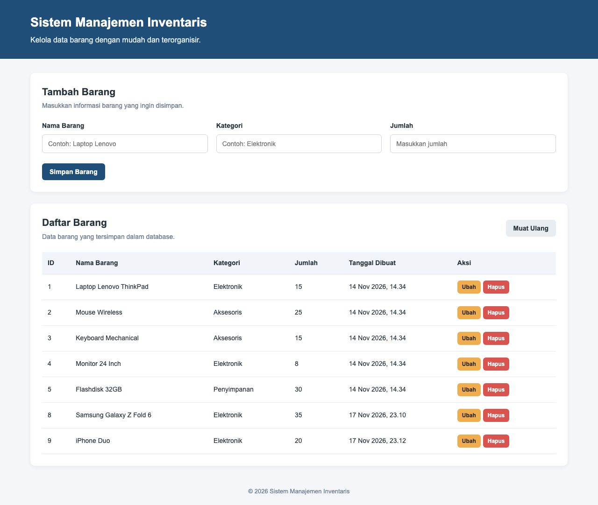

# Sistem Manajemen Inventaris

Project kelompok mata kuliah Service Oriented Architecture dengan tema Simple REST API.

## Penjelasan Aplikasi

Sistem Manajemen Inventaris adalah aplikasi web untuk mencatat data barang, yang terdiri dari nama barang, kategori, dan jumlah. Aplikasi ini memiliki satu layanan, yaitu Product Service, yang dibangun dengan Python dan Flask pada berkas `backend/app.py`. Layanan ini menyediakan REST API di alamat `/api/products` untuk menampilkan, menambah, mengubah, dan menghapus barang. Sebelum menyimpan data, Product Service memeriksa bahwa nama barang dan kategori sudah diisi dan tidak lebih dari 100 karakter, serta jumlah berupa bilangan bulat dari 0 sampai 2147483647. Setiap respons endpoint barang memakai format JSON yang sama, berisi `message` dan `data`. Format ini juga dipakai saat alamat tidak ditemukan, metode HTTP tidak didukung, atau database tidak dapat dihubungi.

Product Service terhubung ke PostgreSQL melalui `backend/database.py`, yang mengambil pengaturan koneksi dari berkas `.env`. Data barang tersimpan pada tabel `products` di database `db_soa`. Flask juga menyajikan antarmuka web yang dibuat dengan HTML, CSS, dan JavaScript. Antarmuka ini tidak mengakses database secara langsung: JavaScript mengirim permintaan ke REST API dengan `fetch`, lalu menampilkan hasilnya sebagai tabel barang dan pesan status. Kontrak API ditulis dalam format OpenAPI pada `backend/openapi.json` dan dapat dibaca melalui Swagger UI di `/api/docs`. Folder `api-requests` berisi koleksi request Bruno untuk menguji endpoint, sedangkan folder `tests` berisi pengujian otomatis untuk API dan tampilan web.

## Tampilan Aplikasi

### Halaman Utama

Pengguna menambah atau mengubah barang melalui form, lalu melihat seluruh barang pada tabel yang dilengkapi tombol Ubah dan Hapus.



### Dokumentasi API

Halaman `/api/docs` menampilkan lima operasi pada endpoint barang beserta skema datanya.


## Daftar URL Endpoint

Pastikan PostgreSQL aktif, lalu jalankan server dari folder project:

```bash
cd backend
python3 app.py
```

Setelah server berjalan, URL berikut dapat diakses. Ganti `{id}` dengan id barang yang ada di database.

| No | Metode | URL | Keterangan |
| --- | --- | --- | --- |
| 1 | GET | [http://127.0.0.1:5001/](http://127.0.0.1:5001/) | Halaman utama aplikasi |
| 2 | GET | [http://127.0.0.1:5001/api/docs](http://127.0.0.1:5001/api/docs) | Halaman dokumentasi API (Swagger UI) |
| 3 | GET | [http://127.0.0.1:5001/api/openapi.json](http://127.0.0.1:5001/api/openapi.json) | Kontrak API dalam format OpenAPI |
| 4 | GET | [http://127.0.0.1:5001/api/products](http://127.0.0.1:5001/api/products) | Menampilkan semua barang |
| 5 | GET | `http://127.0.0.1:5001/api/products/{id}` | Menampilkan satu barang |
| 6 | POST | `http://127.0.0.1:5001/api/products` | Menambah barang |
| 7 | PUT | `http://127.0.0.1:5001/api/products/{id}` | Mengubah barang |
| 8 | DELETE | `http://127.0.0.1:5001/api/products/{id}` | Menghapus barang |

URL dengan metode GET dapat dibuka langsung di browser. POST, PUT, dan DELETE diuji dengan Bruno: buka folder `api-requests` sebagai collection. POST dan PUT memakai body JSON seperti ini:

```json
{
  "product_name": "Mouse",
  "category": "Elektronik",
  "quantity": 10
}
```

Request di folder `api-requests` dibagi menjadi dua kelompok. Kelompok `a` berisi lima operasi utama Product Service, sedangkan kelompok `b` berisi pengujian tambahan, misalnya input yang ditolak, barang yang tidak ada, dan dokumen OpenAPI. Nomor urutnya bersambung, jadi kelompok `b` dimulai dari 06.

| Kelompok | Request | Isi pengujian |
| --- | --- | --- |
| a | a-01 sampai a-05 | Ambil semua barang, ambil barang berdasarkan ID, tambah, ubah, dan hapus barang |
| b | b-06 sampai b-17 | Pastikan barang terhapus, dokumen OpenAPI, validasi input, barang yang tidak ada, endpoint tidak ditemukan, dan metode tidak diizinkan |

Jalankan request kelompok `a` secara berurutan. a-01 mengisi `productId` dengan id barang pertama supaya a-02 bisa langsung dijalankan. a-03 lalu mengganti `productId` dengan id barang yang baru ditambahkan, sehingga a-04 dan a-05 mengubah dan menghapus barang uji tersebut, bukan data asli.

## Anggota Kelompok

| No | Nama | NIM |
| --- | --- | --- |
| 1 | Steven Setiawan  | 32230107 |
| 2 | Kenisha Ellen | 32230114  |
| 3 | Renaldy Runtulalo | 32230132  |
| 4 | Keen Steven Lim | 32230134 |
| 5 | Darren Daniel | 32230138  |
